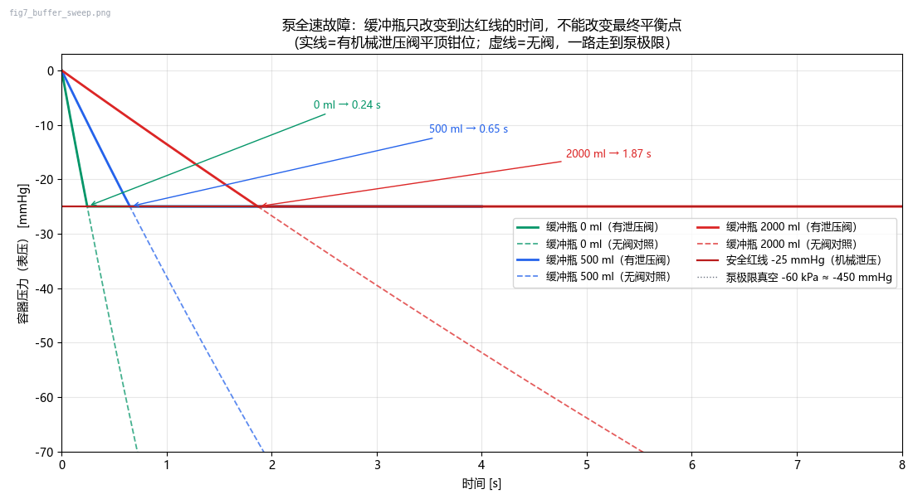
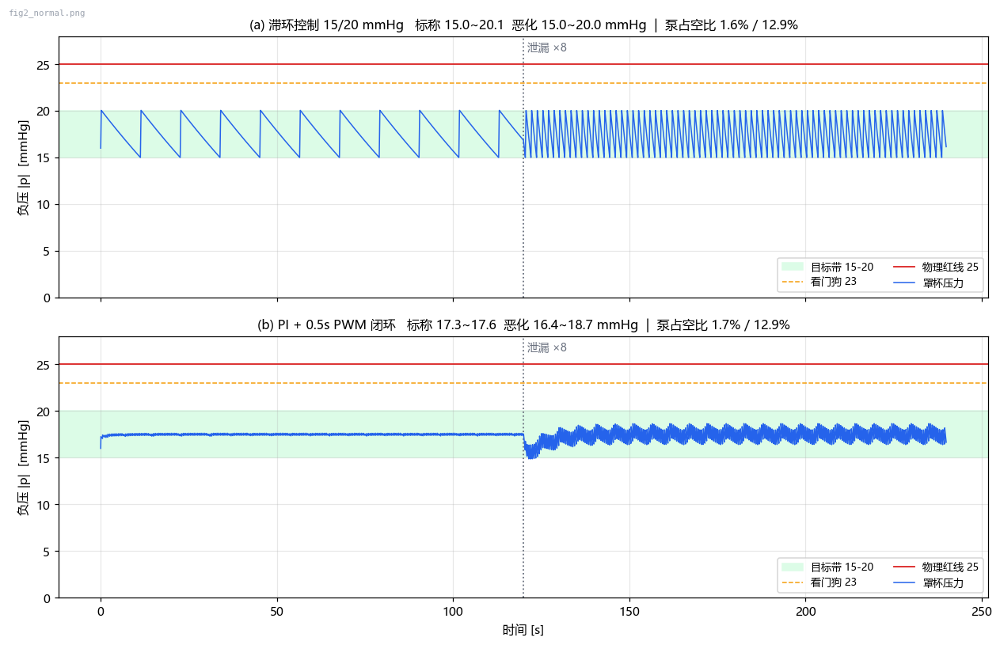

<div align="center">

# Low-Cost Closed-Loop Negative Pressure Controller
### 低成本闭环负压控制器

**纯气动工程理论推导 + 电子电路原型验证**

</div>

---

> # 🔴 🔴 🔴 严禁使用警告 · READ THIS FIRST 🔴 🔴 🔴
>
> <span style="color:#d00000"><b>
> ⛔ 本设计**未经过任何生物学实验**和**临床试验**，没有任何形式的安全有效性背书。
> ⛔ 本设计属于**未注册的第三类医疗器械原理原型**，不是产品、不是器材、不是玩具。
> ⛔ **严禁**任何人将本设计用于人体测试、医疗诊断、治疗或任何形式的商业销售。
> ⛔ 将本设计用于人体的一切行为，均与项目作者无关；作者不承担任何法律与伦理责任。
> </b></span>
>
> 本项目仅允许在**密封气球、硅胶假体、注水模拟皮肤台架**上进行工程验证。
> 生理学背景（15–20 mmHg 产生机械张力、25–30 mmHg 为毛细血管闭合压）**仅供工程
> 阈值定标参考，不构成任何医疗声明**。

---

## 1. 项目简介

这是一个目标硬件成本 **< 500 元人民币** 的微负压闭环控制系统工程原型，用于验证三个
问题的工程可行性：

1. 极低成本下，能否用微差压传感器 + 滞环/PID 把负压**闭环锁定在 15–20 mmHg**；
2. 在 MCU 死机、继电器粘连、传感器短路**同时发生**的复合灾难下，纯物理结构能否把
   负压**钳位在 25 mmHg 以内**；
3. “缓冲瓶换容错、PWM 换舒适、机械阀保底线”这一设计哲学的**定量边界**在哪里。

本仓库提供：数学建模与仿真（Python）、结构件参数化模型（OpenSCAD）、
带四级失效保护的固件（ESP32）、FMEA 审查表，以及完整推导文档。

### 气路拓扑

```text
[模拟端：密封气球 / 硅胶假体 / 注水皮肤台架]   ←— 动态泄漏（湿度、位移）
  │（气密连接，硬管 <30mm）
  │
  ├─ ★ 微压机械泄压阀 ──→ 通大气    【L4 物理底线：24 起跳，钳位 ≤25 mmHg】
  │
[硅胶罩杯 ≈300 ml]
  │ 管路
[微差压传感器 0–10 kPa] ──── ADC ───→ [MCU ESP32]
  │                                     │  ├─ 【L1】滞环/闭环 15–20 mmHg
[缓冲瓶 0.5–2 L]                        │  ├─ 【L2】看门狗 >23 mmHg / 掉线 → 断电
  │                                     │  └─ 硬中断（外部比较器）>25 → 强制断电
[常开型电磁阀] ←—— PWM ————————————————┘
  │         （断电 = 开 = 大气涌入，【L3】）
[微型真空泵 0.5–3 L/min]
```

### 电路原理（示意）

```text
  12V/24V DC ──┬──[继电器 K1 触点]──────────┬── 真空泵电机
               │            ▲               │      │
               │      [ESP32 GPIO26]        │   [续流二极管]
               │            │               │
               ├──[常开电磁阀]◄──[GPIO27 PWM]│
               │
               └──[LM7805/LDO 5V]──[ESP32 VIN]
                        │
  传感器 Vcc ───────────┘（传感器建议独立 LDO 供电 + 100nF 去耦）
  ESP32 GPIO36(ADC1) ◄── 传感器模拟输出（0.5–4.5V）
  ESP32 GPIO4 ◄──────── LM393 比较器输出（基准 23 mmHg，下降沿中断）
  ESP32 GPIO2 ────────── 红色报警 LED（串联 1kΩ）
  急停按钮：常闭触点串在继电器线圈供电回路（拉闸不经 MCU）
```

---

## 2. 技术亮点（设计哲学）

| 哲学 | 数学表达 | 量化结论（仿真验证） |
|---|---|---|
| **空间换容错**（缓冲瓶） | `t = V·Δp / (P_atm·Q)` | 2.5 L/min 泵下：0 / 500 / 2000 ml 缓冲瓶到 25 mmHg 分别为 **0.24 / 0.65 / 1.87 s**；**只改时间不改终点**——无机械阀时终点永远是泵极限 -60 kPa |
| **调制换舒适**（PWM） | 滞环 15/20 + 30% 闭阀占空比 + 15ms 泄压脉冲 | 仿真带内 **15.00–20.05 mmHg**；泄漏劣化 ×8 后占空比 1.6%→12.9% 仍稳定；开环固定 1s/3s 节拍 **0.85 s 冲过安全线**（必须闭环截断） |
| **物理保底线**（机械泄压阀） | `p_clamp = p_crack + (Q_p/K_r)²` | 起跳 24 + 全流量背压 ≤1 → 复合灾难下钳位 **24.70 < 25 mmHg**；起跳 25 字面选型 → 钳位 **27.53 ✗ 越线** |

> 缓冲瓶买的是“秒级时间余量”，机械阀买的是“稳态正确性”。前者是时间维度的冗余，
> 后者是物理维度的底线——**二者不可互相替代**。

### 四层安全防线

| 层 | 机制 | 触发 | 验证结果 |
|---|---|---|---|
| L1 | 软件闭环（滞环 15/20 / PI-PWM） | 正常调节 | 带内 15.00–20.05，看门狗从未触发 |
| L2 | 独立看门狗 + 超压截断 | ≤-23 mmHg、掉线、ADC 卡死 | 掉线 0.5ms 内截断 → 213ms 回常压 |
| L3 | 常开阀断电泄放 | 任意断电 | τ≈77ms，**222ms** 到 <1 mmHg |
| L4 | 机械泄压阀（纯机械） | 24 mmHg 起跳 | 三重灾难下钳位 **24.70**（传感器对 L2 隐身时 L4 独立兜底） |

---

## 3. BOM 清单（淘宝搜索关键词，不含购买链接）

| 部件 | 搜索关键词 | 参考价 |
|---|---|---|
| 微型真空泵 | `微型真空泵 12V 隔膜泵 负压 低噪`（抽速 0.5–3 L/min，极限 -60 kPa） | 25–60 |
| 常开电磁阀 | `常开电磁阀 12V 1/8 英寸 真空` | 10–20 |
| 微差压传感器 | `XGZP101 微差压传感器 0-10kPa`（或 `±10kPa 压力变送器 模拟输出`） | 25–60 |
| 机械泄压阀 | `微压安全阀 起跳压力 可调 3kPa`（或 `真空超压保护阀 25mmHg 定制`）★见注 | 15–50 |
| 缓冲瓶 | `广口密封瓶 500ml 带盖` / `试剂瓶 1L` | 5–15 |
| MCU | `ESP32开发板 WROOM` | 15–30 |
| 继电器模块 | `1路继电器模块 5V 光耦 带接线端子` | 3–8 |
| 机械真空表 | `真空压力表 -60~0 kPa 表盘 6mm` | 10–25 |
| 硅胶管 | `医用硅胶管 内4mm 外6mm` | 5–10 |
| 电源 | `12V 2A 电源适配器 DC` | 10–20 |
| 密封件 | `铂金硫化硅胶O型圈`（**天然橡胶禁用，致敏**） | 5–10 |
| 打印材料 | `医用级光敏树脂` 或 `PETG 耗材`（**普通 PLA 禁用**） | 30–80 |

> ★ 机械泄压阀是全系统**唯一不可妥协件**：必须按 `起跳 24 mmHg + 全泵流量下
> 背压 ≤1 mmHg` 校核（公式与曲线见《微负压系统数学建模.md》§5.2 / fig6 右图）。
> 达不到该指标的泄压阀会让 L4 在复合灾难下越线（实测仿真：27.53 > 25）。

---

## 4. 台架测试数据（仿真数据，非人体、非实测）

> 下表由 `model.py` / `buffer_sweep.py` 数值仿真产生（dt=0.5ms，等温集总模型，
> 参数见建模文档 §2/§9）。真实台架需按同表格式回填实测值；
> **实测执行 [通气实验方案.md](通气实验方案.md)（S0–S7，判据即仿真预测值）。**
>
> ⚠️ 本章全部数据为**仿真结果，非人体、非实测**，不可作为任何医疗依据。

### 4.1 不同缓冲瓶容积下的超压保护响应时间
（泵故障全速 2.5 L/min，初始常压，机械阀 25 mmHg 平顶钳位）

| 缓冲瓶容积 | 总容积 | 到达 -25 mmHg（有阀） | 解析值 | 无阀走到 -60 kPa |
|---|---|---|---|---|
| 0 ml | 300 ml | **0.24 s** | 0.24 s | 4.3 s |
| 500 ml | 800 ml | **0.65 s** | 0.63 s | 11.4 s |
| 2000 ml | 2300 ml | **1.87 s** | 1.82 s | 32.7 s |



### 4.2 复合灾难场景（MCU 死机 ∧ 继电器粘连 ∧ 传感器短路恒读 -5）

| 配置 | 到 23 mmHg | 到 24 mmHg | 稳态钳位 | 判定 |
|---|---|---|---|---|
| 1L 缓冲 + 合格泄压阀 | 203 ms | 239 ms | **24.70** | ✅ < 25 |
| 无缓冲瓶 + 合格泄压阀 | 46 ms | 55 ms | **24.70** | ✅ 但电子层无反应时间 |
| 1L + 泄压阀选型错误 | 203 ms | 239 ms | **27.53** | ❌ 越线（选型规范的反面教材） |

### 4.3 正常闭环与故障响应

| 场景 | 结果 |
|---|---|
| 滞环闭环，标称泄漏 | 带内 **15.00–20.05 mmHg**，泵占空比 1.6% |
| 滞环闭环，泄漏 ×8 劣化 | 带内 **15.00–20.04 mmHg**，占空比 12.9%，看门狗未触发 |
| PI-PWM 闭环 | 标称 17.32–17.63；劣化后 16.39–18.66（仍带内） |
| 断电泄放（L3） | τ=77 ms，**222 ms** 到 <1 mmHg |
| 传感器掉线（L2） | ≤1 采样周期截断，213 ms 回常压 |
| 开环固定 1s/3s PWM | 0.85 s 冲 24 → 电子层失效时被机械阀锁在 24.7 高位 ✗ 违规工况 |



---

## 5. 仓库结构

```text
.
├── README.md                     ← 本文件
├── LICENSE                       # CC BY-NC-SA 4.0 官方全文（非商用 · 相同方式共享）
├── 微负压系统数学建模.md           # 完整推导：方程、解析定律、仿真结果、定型参数
├── FMEA.md                        # 20 项失效模式审查 + 台架安全生存指南
├── 通气实验方案.md                 # 台架通气实验：S0–S7 步骤/判据/记录表（判据=仿真预测）
├── model.py                       # 主仿真：闭环 + 四层防线 + 灾难场景（输出 figs/）
├── sim_upgrade.py                 # 升级包：求解器交叉验证/热力学/MC/阀动态（fig8..10）
├── buffer_sweep.py                # 缓冲瓶容积扫描专项：0/500/2000 ml + 平顶钳位曲线
├── firmware/
│   └── pressure_controller/
│       └── pressure_controller.ino  # ESP32 固件（Arduino 标准 sketch 目录结构）
├── openscad/
│   ├── cup_adapter.scad           # 硅胶罩杯转接头（Ø2 泄压阀孔 + 6mm 宝塔）
│   ├── pcb_enclosure.scad         # ESP32+继电器+传感器外壳（散热/排水/M3）
│   └── bottle_cap.scad            # 28mm 瓶口盖（双 6mm 宝塔 + O 圈槽）
├── stl/                           # 渲染产物：三个结构件成品 *.stl + 装配视图
│   └── views/                     # 多视图工程图 sheet_*.png（front/top/side/iso）
│                                  # （preview_*.png / *_bin.stl / angles/ 为中间产物，未入库）
├── stl_check.py                   # STL 体检（连通分量/边配对）
├── make_multiview.py              # 多视图生成器（正投影渲染+视角语义自校验）
└── figs/                          # 仿真输出图（拓扑/闭环/灾难/泄放/PWM/设计曲线）
```

### 验证状态（工具链：开源社区方案，全部实机跑通）

| 对象 | 工具 | 结果 |
|---|---|---|
| 三个结构件几何 | OpenSCAD 2021.01（便携版）CGAL 渲染 | ✅ 三件均 `Simple: yes`，导出 STL |
| STL 可打印性 | trimesh 4.9.0（水密/绕序/分量） | ✅ cup 单体、bottle 单体、pcb 底座+上盖双体，全部 watertight |
| 结构件外观 | 渲染预览目检（judge 独立复核） | ✅ 三件 pass：无悬空/破面/挖穿 |
| 验证过程修复的几何 bug | — | 螺纹切削共面碎屑(5060体)、安装柱相切非流形、`bore()`倒角跟错局部坐标吃掉宝塔底环、顶部沉孔掏空宝塔落脚面、密封圈槽实际只有0.1mm深 —— 共 5 处，均已修复并回归验证 |
| 串联接口审计（总装级） | system_assembly.scad + 坐标核算 | 修复 6 项：①瓶盖新增传感器取压口Ø4(P0断链) ②瓶盖新增第二泄压预留口Ø2(FMEA双阀) ③宝塔按管内径重设计(齿Ø5.2,过盈30%) ④主气道Ø6→Ø4(否则宝塔基环无搭接、断成两体) ⑤外壳散热槽贯穿+USB烧录口 ⑥绑扎凸环改真凹槽 |
| 多视图工程图 | make_multiview.py（正投影4视角×4件+轮廓比视角自校验） | ✅ 16 视角 ALL PASS，输出 `stl/views/sheet_*.png` |
| 仿真可信度与统计量化 | scipy DOP853 + CoolProp 6.7.0 + 20k 蒙特卡洛 + 弹簧阀动力学（`sim_upgrade.py`） | ✅ A 双求解器偏差 0.41 Pa；B 物性偏差 0.50%、热漂移 3.7<5 mmHg；C 现行起跳规格 P(>25)=**39.2%** → 收紧至 23.0±0.5 得 2.3%；D 真实阀钳位 27.8 越线 → **K_r 规格 4.8e-6→≥2.1e-5（推荐 4.5e-5）**，加大阀座 24.4 ✓ 0.25s 稳定无颤振；E 噪声×量化×零漂抖振：滤波后各工况真值带 ≤22.6 鲁棒（**16 点平均为强制项**，§10 全部关闭） |
| ESP32 固件 | arduino-cli 1.5.1 + esp32:esp32@3.3.12，`--warnings all` | ✅ 编译通过：**0 error / 0 warning**，Flash 276 951 B (21%)，RAM 22 912 B (6%) |

> **受限网络下的核心安装备注**：GitHub 直连不稳定时，可用“裁剪索引法”——
> 用 curl（走可用镜像，`-C -` 断点续传）预取 `esp32:esp32` 所需的工具/平台 zip 到
> `arduino-downloads/packages/`，再把 `package_esp32_index.json` 裁剪成只含已就绪依赖的
> 本地索引（仅留 `esp32:esp32` 目标所需 13 项，剔除 S2/S3/P4/C6 等其他芯片库，约省 340 MB），
> 经本地 HTTP 提供给板管理器完成离线安装。本仓库仅验证经典 ESP32 目标
> （`esp32:esp32:esp32`）；其余芯片的编译在联网后执行 `arduino-cli core install esp32:esp32`
> 补全即可。

## 6. 许可证

本仓库全部内容（文档、仿真代码、结构件模型、固件、图片与 STL）采用
**[Creative Commons Attribution-NonCommercial-ShareAlike 4.0 International
(CC BY-NC-SA 4.0)](LICENSE)** 许可协议发布。

| 你可以 | 你必须 |
|---|---|
| 自由复制、传播、修改、再创作 | **署名**（注明原作者与本仓库链接） |
| 用于学习、研究、非营利工程验证 | **非商业**（不得用于任何商业目的/销售） |
| 基于本作品继续开发 | **相同方式共享**（衍生作品须沿用 CC BY-NC-SA 4.0） |

协议全文见 [LICENSE](LICENSE)，或访问
<https://creativecommons.org/licenses/by-nc-sa/4.0/legalcode>。

> 该协议已包含**免责声明与责任限制**条款（Section 5），与本仓库「未注册医疗器械
> 原理原型、严禁人体使用、严禁商业销售」的立场一致。
> **任何将本设计用于人体的行为，均与作者无关。**

---

## 7. 快速开始

> **一键回归**：双击 `run_all.bat`（自动切到本目录依次跑三个脚本，结束暂停不闪退）。
> 命令行请在**本目录**执行 `python model.py`——注意是 `python` 不是 `py`
> （本机未装 Windows py 启动器，`py xxx` 会报 command not found）。

```bash
# 1) 数值仿真（Python ≥3.8，依赖 numpy/scipy/matplotlib）
python model.py            # 主模型：正常闭环 + 灾难场景 + 四层防线验证
python sim_upgrade.py      # 升级包：交叉验证/热力学/蒙特卡洛/阀动态（fig8..10）
python buffer_sweep.py     # 缓冲瓶容积扫描（0/500/2000 ml 平顶钳位曲线）

# 2) 结构件：OpenSCAD 渲染导出 STL + 体检
openscad -o stl/cup_adapter.stl    openscad/cup_adapter.scad
openscad -o stl/bottle_cap.stl     openscad/bottle_cap.scad
openscad -o stl/pcb_enclosure.stl  openscad/pcb_enclosure.scad
python stl_check.py stl/*.stl      # 连通分量 / 边配对检查
# 打印材料仅限 医用级光敏树脂 / PETG（普通 PLA 禁用）

# 3) 固件：Arduino-ESP32 核心编译烧录
arduino-cli compile --fqbn esp32:esp32:esp32 firmware/pressure_controller
# 烧录后必须先跑台架自检三步（见 FMEA.md 生存指南 B 节）
```


---

<div align="center">

### 🔴 再次声明

**未生物学实验 · 未临床验证 · 未注册三类医疗器械原理原型**
**严禁人体使用 · 严禁医疗诊断 · 严禁商业销售 · 违者后果自负**

*Engineering is the discipline of knowing where the line is — and never crossing it.*

</div>
